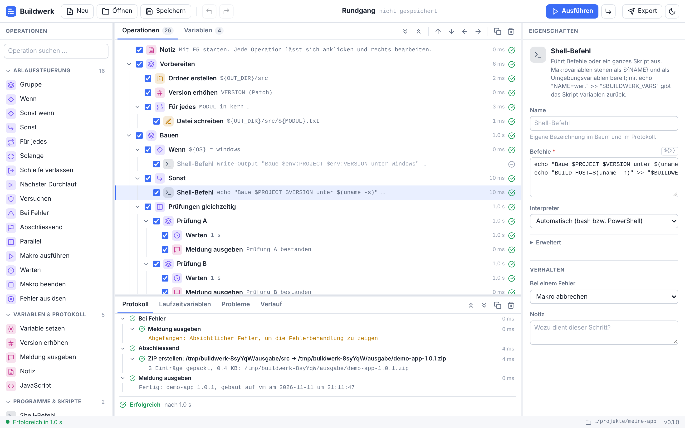
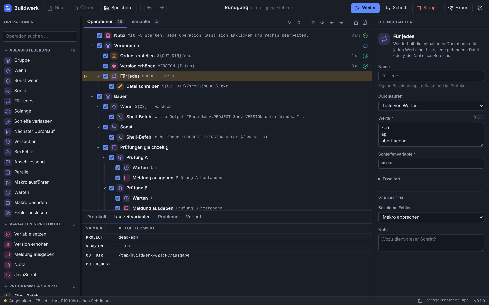

# Buildwerk

Visuelle Build- und Release-Automatisierung: Abläufe werden als Baum aus fertigen Operationen zusammengeklickt, lokal ausgeführt und Schritt für Schritt debuggt – und dieselbe Makrodatei läuft ohne Oberfläche in CI.

Die Idee stammt von den klassischen visuellen Build-Werkzeugen der 2000er-Jahre. Buildwerk ist eine eigenständige Neuentwicklung für heutige Verhältnisse: plattformunabhängig, mit Makros als lesbaren Textdateien für Git, parallelen Schritten, Containern und einem Export nach GitHub Actions.





## Schnellstart

Voraussetzung ist Node.js 20 oder neuer. Es gibt keine weiteren Abhängigkeiten und keinen Build-Schritt.

```bash
node buildwerk/bin/buildwerk.js serve
```

Danach <http://127.0.0.1:4800> öffnen und «Rundgang laden» wählen – das Beispielmakro zeigt Variablen, Schleifen, Bedingungen, parallele Schritte und Fehlerbehandlung und schreibt nur in einen temporären Ordner. In GitHub Codespaces den weitergeleiteten Port 4800 öffnen; der Hostname des Codespace wird automatisch zugelassen.

Der Arbeitsbereich ist der Ordner, in dem Makros gesucht und gespeichert werden. Standard ist der aktuelle Ordner, mit `--workspace <ordner>` lässt er sich wählen.

## Die Oberfläche

| Bereich | Inhalt |
| --- | --- |
| Links | Alle Operationen, durchsuchbar und nach Kategorie gruppiert. Doppelklick oder Ziehen fügt eine ein. |
| Mitte | Das Makro als Baum. Häkchen aktivieren und deaktivieren Schritte, der Rand links setzt Haltepunkte. Der zweite Reiter enthält die Variablen. |
| Rechts | Eigenschaften der gewählten Operation. Der Knopf `${x}` fügt eine Variable ein. |
| Unten | Protokoll (ein einklappbarer Abschnitt pro Operation), aktuelle Variablenwerte, Probleme und der Verlauf früherer Läufe. |

| Taste | Wirkung |
| --- | --- |
| F5 | Ausführen bzw. nach einer Pause fortsetzen |
| Umschalt+F5 | Stoppen |
| F10 | Einzelschritt; im Leerlauf: schrittweise starten |
| F9 | Haltepunkt setzen oder entfernen |
| Strg+S / Strg+O | Speichern / Öffnen |
| Strg+Z / Strg+Y | Rückgängig / Wiederholen |
| Alt+↑ / Alt+↓ | Operation nach oben oder unten verschieben |
| Alt+← / Alt+→ | Aus dem Block heraus / in den Block darüber |
| Strg+D, Entf, Leertaste | Duplizieren, Löschen, Aktivieren/Deaktivieren |

Über das Kontextmenü lässt sich ein Makro ab einer bestimmten Operation starten oder eine einzelne Operation allein ausführen.

## Variablen

Variablen werden überall als `${NAME}` eingesetzt und stehen Skripten und Programmen zusätzlich als Umgebungsvariablen zur Verfügung.

- **Standardwerte** dürfen frühere Variablen und Systemvariablen verwenden, etwa `${TEMP_DIR}/ausgabe`.
- **Geheim:** Der Wert erscheint im Protokoll als `***`. Bleibt der Standardwert leer, wird die gleichnamige Umgebungsvariable verwendet – so steht kein Passwort in der Makrodatei.
- **Persistent:** Der Wert am Ende eines Laufs ist der Startwert des nächsten, zum Beispiel für eine fortlaufende Build-Nummer. Er liegt neben dem Makro in einer `.state.json`-Datei.
- **Aus Skripten zurückgeben:** `echo "NAME=wert" >> "$BUILDWERK_VARS"` setzt eine Makrovariable.
- `${env:NAME}` liest eine Umgebungsvariable, `$${NAME}` ergibt den wörtlichen Text `${NAME}`.
- Ein Verweis auf eine Variable, die es nicht gibt, bricht die Operation mit einer klaren Meldung ab. Ausnahme sind Shell-Skripte: dort bleibt Unbekanntes stehen, weil `${…}` der Shell gehören kann.

Systemvariablen wie `${BASE_DIR}`, `${DATE}`, `${TIMESTAMP}`, `${OS}` oder `${ERROR_MESSAGE}` sind im Reiter «Variablen» aufgelistet.

## Operationen

| Kategorie | Operationen |
| --- | --- |
| Ablaufsteuerung | Gruppe, Wenn / Sonst wenn / Sonst, Für jedes (Liste, Dateien, Zahlenbereich), Solange, Schleife verlassen, Nächster Durchlauf, Versuchen / Bei Fehler / Abschliessend, Parallel, Makro ausführen, Warten, Makro beenden, Fehler auslösen |
| Variablen & Protokoll | Variable setzen, Version erhöhen, Meldung ausgeben, Notiz, JavaScript |
| Programme & Skripte | Shell-Befehl (bash, sh, PowerShell, cmd, Python, Node.js), Programm starten |
| Dateien & Ordner | Kopieren, Verschieben, Löschen, Ordner erstellen, Datei schreiben, Datei lesen, Text ersetzen, ZIP erstellen, ZIP entpacken |
| Git | Klonen, Aktualisieren, Auschecken, Commit, Tag setzen, Hochladen, Stand auslesen |
| Build-Werkzeuge | npm / pnpm / yarn, .NET, MSBuild, Maven, Gradle, Make, CMake, Cargo, Go, Python |
| Container | Image bauen, Image hochladen, Container starten, Docker Compose |
| Netzwerk | HTTP-Anfrage, Datei herunterladen, Benachrichtigung (Slack, Teams, Discord, eigener Webhook) |

Jede Operation kann einzeln auf «Fehler ignorieren und fortfahren» gestellt werden. Dateioperationen sind in Node.js umgesetzt und verhalten sich deshalb auf allen Plattformen gleich; Git, Build-Werkzeuge und Docker rufen die jeweiligen Kommandozeilenprogramme auf, die installiert sein müssen.

## Kommandozeile

```bash
buildwerk run build.buildwerk.json                 # Makro ausführen
buildwerk run build.buildwerk.json --var CONFIG=Debug
buildwerk validate build.buildwerk.json            # prüfen, ohne auszuführen
buildwerk export build.buildwerk.json -o .github/workflows/build.yml
buildwerk list                                     # alle Operationen
```

`buildwerk` steht hier für `node buildwerk/bin/buildwerk.js`. Der Exit-Code ist 0 bei Erfolg, 1 bei einem Fehler und 130 nach einem Abbruch. Variablen lassen sich auch über die Umgebung setzen: `BW_VAR_CONFIG=Debug`.

## GitHub Actions

«Export» erzeugt einen Workflow, der das Makro bei jedem Push und auf Knopfdruck über die Kommandozeile ausführt. Nicht geheime Variablen werden zu Eingabefeldern des manuellen Starts, geheime Variablen kommen aus den gleichnamigen Repository-Secrets. Alle Werte gelangen über Umgebungsvariablen ins Makro, nie über die Befehlszeile.

## Makrodateien

Makros sind JSON-Dateien mit der Endung `.buildwerk.json` und für Diffs und Code-Reviews gedacht:

```json
{
  "format": "buildwerk/1",
  "name": "Mein Build",
  "variables": [{ "name": "CONFIG", "value": "Release" }],
  "operations": [
    {
      "id": "op_a1b2c3d4",
      "type": "flow.group",
      "name": "Bauen",
      "enabled": true,
      "props": {},
      "children": [
        { "id": "op_e5f6a7b8", "type": "build.npm", "enabled": true, "props": { "manager": "npm", "command": "ci" } }
      ]
    }
  ]
}
```

«Sonst», «Bei Fehler» und «Abschliessend» stehen als Geschwister direkt nach ihrem «Wenn» bzw. «Versuchen».

## Aufbau

```
bin/buildwerk.js        Kommandozeile
src/engine.js           führt den Operationsbaum aus und meldet Ereignisse
src/catalog/            alle Operationen: Feldbeschreibung + Ausführungsfunktion
src/server.js           lokaler Server für den Editor
src/shared/             Datenmodell, Validierung, Export – läuft in Node und im Browser
public/                 der Editor (reines JavaScript, kein Framework, kein Build)
examples/               Vorlagen
test/                   Tests (node --test)
```

Eine neue Operation ist ein Eintrag im Katalog. Das Formular im Editor entsteht aus der Feldbeschreibung:

```js
// src/catalog/files.js
{
  type: 'file.touch',
  category: 'file',
  label: 'Datei anlegen',
  icon: 'file',
  description: 'Legt eine leere Datei an oder aktualisiert ihr Änderungsdatum.',
  fields: [filePath('file', 'Datei', { required: true })],
  summary: '{file}',
  async run(ctx, p) {
    await fs.appendFile(ctx.path(p.file), '');
    ctx.log(`Angelegt: ${p.file}`);
  },
}
```

## Sicherheit

Der Editor-Server führt Befehle aus und ist deshalb abgesichert: Er bindet nur an `127.0.0.1`, lehnt fremde `Host`-Header ab und verlangt bei jedem Aufruf ein Token, das bei jedem Start neu erzeugt wird. Hinter einem Proxy lässt sich ein zusätzlicher Hostname mit `--allow-host` freigeben. `--allow-any-host` schaltet die Prüfung ab und gehört nur in abgeschottete Umgebungen.

Makros können beliebige Programme starten. Ein Makro aus fremder Quelle sollte man lesen, bevor man es ausführt – wie jedes Build-Skript.

## Tests

```bash
cd buildwerk && npm test
```

Die Tests decken die Ausführungs-Engine, Dateioperationen und ZIP, Git, HTTP, den Export und den Server samt Zugriffsschutz ab.

## Stand und Grenzen

Version 0.1 ist ein erster, lauffähiger Stand.

- Entwickelt und getestet unter Linux. Die Windows-Pfade (Aufruf von `.cmd`-Dateien, PowerShell, Beenden von Prozessbäumen) sind umgesetzt, aber noch nicht auf einem Windows-Rechner geprüft. Dasselbe gilt für macOS und für den Betrieb in GitHub Codespaces.
- Noch nicht enthalten: E-Mail- und FTP-Versand, Windows-Spezifisches (Registry, Dienste, IIS), Eingabedialoge beim Start, Zeitplanung, verteilte Ausführung. Vieles davon geht einstweilen über «Shell-Befehl».
- ZIP-Archive sind auf 4 GB begrenzt (kein ZIP64).
- Die Oberfläche ist deutsch.

Die Icons folgen dem Stil des Feather-Icon-Sets (MIT-Lizenz).
